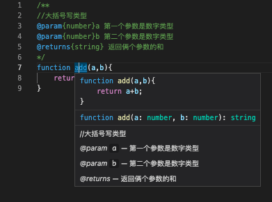

# 代码规范

## 🚀代码格式化(.prettierrc)
```json
{
    "arrowParens": "avoid",
    "jsxSingleQuote": true,
    "bracketSameLine": true,
    "tabWidth": 4,
    "singleQuote": true,
    "useEditorConfig": false,
    "singleAttributePerLine": true,
    "printWidth": 160,
    "enableDebugLogs": true,
    "htmlWhitespaceSensitivity": "ignore"
}
```

## 🚀.snippets
```json
{
	"Print console with color": {
		"prefix": "clog",
		"scope": "javascript,typescript,vue,typescriptreact",
		"body": [
			"console.log('%c $1:', 'color: green', $2);",
		],
	},

	"function commnet": {
		"prefix": "**",
		"scope": "javascript,typescript,vue,typescriptreact",
		"body": [
			"/** @desc $1 */",
		],
	},

	"todo commnet": {
		"prefix": "tt",
		"scope": "javascript,typescript,vue,typescriptreact",
		"body": [
			"// ======TODO $1======",
		],
	},


	"markdown 折叠代码块模版": {
        "prefix": "details",
		"scope": "markdown",
        "body": [
            "<details>\r\n\t<summary>$1</summary>\r\n\r\n```json\r\n```\r\n</details>",
            "$2"
        ],
        "description": "Log output to console"
    },


	"markdown pre标签": {
        "prefix": "pre",
		"scope": "markdown",
        "body": [
            "<pre>$1</pre>",
        ],
        "description": "markdown中快速生成pre标签"
    }
}
```

## 🚀函数注释  
```js
/**
//大括号写类型
@param {number}a 第一个参数是数字类型
@param {number}b 第二个参数是数字类型
@returns {string} 返回俩个参数的和
*/
function add(a,b){
    return a+b;
}
```


::: tip
1. 代码注释解释的应该是why问题，而不是what问题
2. 良好的代码具有‘自我解释’功能，能够解决what问题
3. 注释解决why问题，告诉读者代码为什么这么写
4. 与其纠结如何写好注释，不如先考虑先把代码写好
5. 不必要的地方不要写注释
6. 功能复杂的函数拆分成功能单一的小函数
> tips:其实写代码注释要根据具体的情况来定，但是最好根据以上的原则来进行
:::
