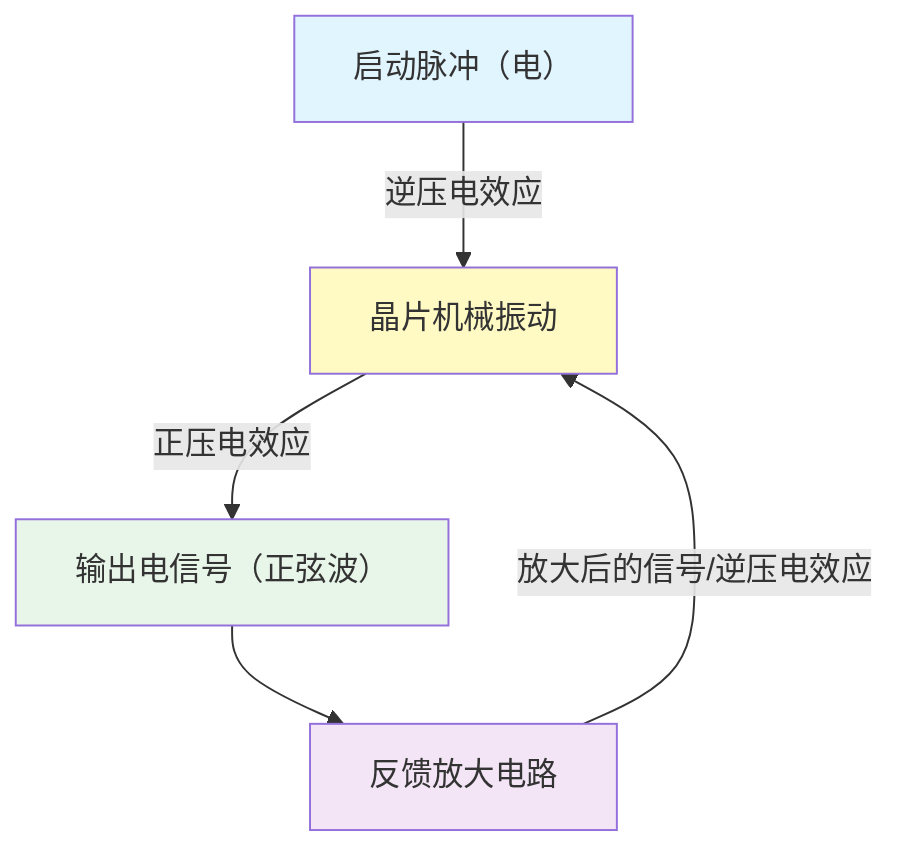

# 计算机的“心跳”之源：从CPU频率到石英晶振

## 📖 概述

现代计算机的运行速度——无论是5GHz还是3GHz——都源于一个极其精密的物理器件：**石英晶体振荡器（晶振）**。本文从CPU频率出发，深入探究晶振的工作原理、物理基础、信号传输方式及生产条件，帮助你建立完整的知识链条。

---

## 一、CPU频率：5GHz意味着什么？

**CPU频率**指的是CPU每秒钟执行的时钟周期数：
- **5GHz = 50亿次/秒**
- 每个时钟周期，CPU可以执行一条或多条指令

**频率 ≠ 性能唯一指标**：
- IPC（每周期指令数）—— 架构效率
- 核心数 —— 并行处理能力
- 缓存大小 —— 数据读写速度
- 功耗与散热 —— 高频带来的热量

**关键理解**：频率是CPU工作的“节奏”，而这个节奏需要一个稳定的“节拍器”来提供——这就是**晶振**的职责。

---

## 二、晶振的核心原理：压电效应

晶振的灵魂是**石英晶体（SiO₂）**，它利用**压电效应**工作：

| 效应方向 | 过程 | 应用 |
|---------|------|------|
| **正压电效应** | 机械压力 → 产生电压 | 输出电信号 |
| **逆压电效应** | 施加电压 → 物理形变 | 启动/维持振动 |

**工作循环**：

---

## 三、石英 vs 玻璃：同是SiO₂，有何不同？

两者化学组成相同，但**原子排列结构**截然不同：

| 特性 | 石英（晶体） | 玻璃（非晶体） |
|------|-------------|---------------|
| **微观结构** | 原子长程有序（阅兵式） | 原子长程无序（拥挤人群） |
| **压电效应** | ✅ 有 | ❌ 无 |
| **物理形态** | 规则几何外形的晶体 | 可塑形，无规则外形 |
| **硬度** | 高（莫氏7，可划伤玻璃） | 较低（5.5-6.5） |
| **熔点** | 有固定熔点（1713°C） | 无固定熔点，逐渐软化 |

**结论**：CPU的晶振必须用**石英**——它高度有序的原子结构赋予了压电效应，使其能成为精确的“节拍器”；而玻璃没有压电效应，只能做“窗户”。

---

## 四、晶振如何传递信号？

晶振输出的**不是机械振动，而是电信号**。

### 输出形式：
- **无源晶振**：输出**正弦波**（微弱，需外部电路驱动）
- **有源晶振**：输出**方波**（TTL/CMOS电平，可直接使用）

### 传递路径：
石英晶片（机械振动）→ 电极（压电效应）→ 正弦波电信号 → 引脚焊接 → PCB导线 → CPU时钟输入

### 输出是否会消耗振动能量？
**会。这就是能量守恒的体现！** 但解决方案是：
1. 晶振本身**Q值极高**（数万~数十万），机械损耗极低
2. 输出电路**输入阻抗极高**（兆欧级），抽取能量微乎其微
3. **反馈放大电路**持续补充能量，维持稳定振荡

**能量平衡公式**：
> 放大器提供的能量 ≥ 晶振自身机械损耗 + 输出电路取走的能量

这不是永动机，而是高效的**电能→机械能→电能**转换系统。

---

## 五、振动会衰减吗？如何维持？

**会衰减**。你的直觉完全正确——没有能量补充，振动会像被敲响的音叉一样逐渐停止。

**解决方案：正反馈放大电路**

晶振**从不单独工作**，必须连接放大电路形成**振荡电路**（如皮尔斯振荡器）：
1. **启动**：电路通电时的噪声提供初始微小振动
2. **放大**：放大器将晶振输出的微弱信号放大
3. **反馈**：放大的信号送回晶振，通过逆压电效应给晶片“补一脚”
4. **稳定**：当补充能量 = 损耗能量时，系统达到动态平衡，**持续稳定振荡**

---

## 六、晶振的生产条件与技术含量

### 生产条件的苛刻
| 要求 | 标准 |
|------|------|
| **洁净度** | 万级净化车间（每立方英尺<1万个0.5μm颗粒） |
| **温度** | 25℃ ± 3℃ |
| **湿度** | 50% ± 10% |
| **纯度** | 石英原料纯度 > 99.999% |
| **电极精度** | 100-200纳米，均匀性误差 < 5纳米 |

### 技术含量体现
- **原子级加工**：晶片切割、研磨、抛光需达到原子级平整度
- **光刻加工**：高端晶振需像制造芯片一样光刻电路图形
- **严苛测试**：-40℃~+125℃温度循环 + 3000小时老化试验
- **长期可靠性**：15年老化率控制在几十ppm（百万分之一）以内

---

## 七、历史：晶振是谁发明的？

晶振的发明是跨世纪科学家接力的结果：

| 年份 | 科学家 | 贡献 |
|------|--------|------|
| **1880年** | 雅克·居里 & 皮埃尔·居里 | 发现**压电效应**（理论基础） |
| **1918年** | 亚历山大·尼科尔森 | 制造早期谐振装置（使用酒石酸钾钠，非石英） |
| **1921年** | **沃特·盖顿·凯蒂** | 制造**第一个石英晶体振荡器**（被公认为“石英晶体振荡器之父”） |
| **1928年** | 沃伦·马里森（贝尔实验室） | 制造**第一座石英钟** |
| **1950年代** | 贝尔实验室 | 解决人造石英晶体量产问题 |

> **最终答案**：晶振的发明是**居里兄弟（发现原理）→ 凯蒂教授（造出成品）→ 贝尔实验室（实现量产）** 的产物。凯蒂教授因1921年的开创性工作，被视为晶振的实际缔造者。

---

## 八、全球主要晶振生产商

| 梯队 | 厂商 | 地区 | 特点 |
|------|------|------|------|
| **第一梯队** | Seiko Epson (爱普生)、NDK、TXC、KDS、Murata | 日本/台湾 | 技术领先，市场份额高 |
| **新兴力量** | SiTime | 美国 | MEMS振荡器领导者 |
| **国产替代** | SJK(晶科鑫)、YXC(扬兴科技)、泰晶科技 | 中国大陆 | 快速追赶，车规级突破 |

---

## 九、知识要点速查表

| 问题 | 答案 |
|------|------|
| CPU的5GHz是什么？ | 每秒50亿个时钟周期 |
| 什么提供时钟基准？ | 石英晶体振荡器（晶振） |
| 晶振凭什么工作？ | 压电效应（居里兄弟发现） |
| 石英和玻璃的区别？ | 石英是晶体（有序），玻璃是非晶体（无序） |
| 晶振输出什么信号？ | 无源：正弦波；有源：方波 |
| 振动会停吗？ | 会，但反馈放大电路持续补能维持 |
| 输出会消耗能量吗？ | 会，但补充能量大于消耗能量 |
| 谁发明了晶振？ | 凯蒂教授（1921年第一个石英振荡器） |

---

## 十、延伸思考

1. **MEMS硅振荡器**正在崛起，它不需要石英晶体，采用全硅半导体工艺，抗振动、可编程、交付周期短，是否会取代传统石英晶振？

2. **原子钟**（如铯原子钟）精度远高于晶振，但体积和成本限制了应用范围。未来是否有消费级原子钟？

3. 晶振的老化最终会导致频率漂移超出规范，这是电子产品淘汰的物理极限之一。

---

*📌 本文档可作为个人知识库的“时钟与晶振”专题页，建议配合示波器实测晶振波形加深理解。*